# Pixel Pomodoro

**An 8-bit pomodoro timer for your second monitor, and now your phone.**

A split-flap countdown like an old railway board sits over a hand-coded pixel-art city. A little pixel person walks around, and the weather falls around him. Ten scenes, from Mt Fuji to Mexico City.


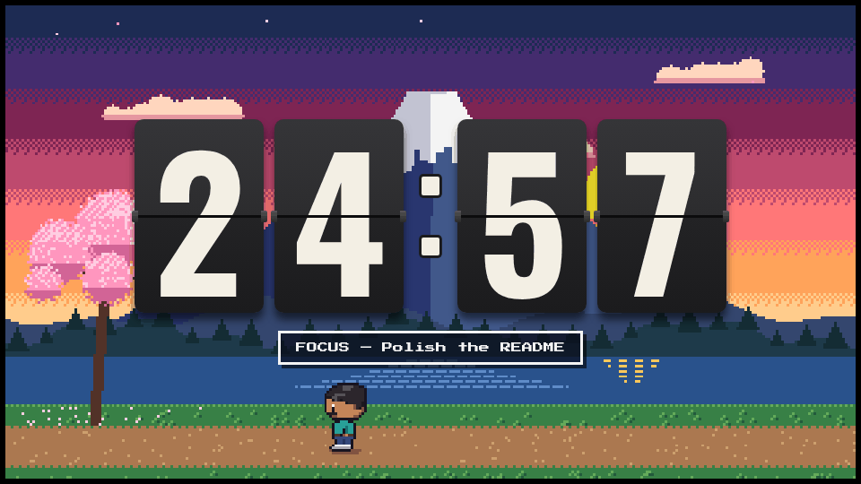

## 📱 Also on your phone

Pixel Pomodoro runs on **Android** too: the same scenes, clock and sprite in a landscape, full-screen app. Your settings and session history stay on the device, and a notification plays the 8-bit chime when a phase ends, even if the phone is locked.

**[⬇ Download the APK](https://github.com/Jcardenas34/pomodoro_timer_pixel/releases/latest)** · [install steps](#android)

<p align="center">
  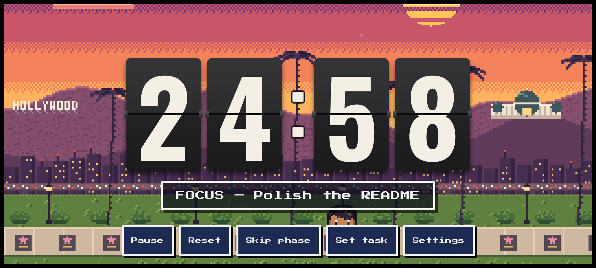
</p>

## Features

- **Split-flap clock.** Each digit flips like a railway departure board.
- **Ten pixel-art cities**, all generated in code (Python + Pillow), each with its own weather: cherry petals, rain with splashes, snow, fountain mist, fireflies, jacaranda petals, autumn leaves.
- **A walking sprite** with four hairstyles and a mustache toggle, built from a role-coded walk-cycle template.
- **Picture-frame border.** Pick its color and width.
- **Task label + session log.** Name what you're working on; every focus block is saved to SQLite (desktop) or on-device storage (Android).
- **Configurable cycle.** Work, short and long break lengths, long-break interval, auto-start, chime on/off.
- **Built for a second monitor.** Full screen on the screen you choose, and the controls hide after 3 seconds.

## Gallery

| | |
|:-:|:-:|
| 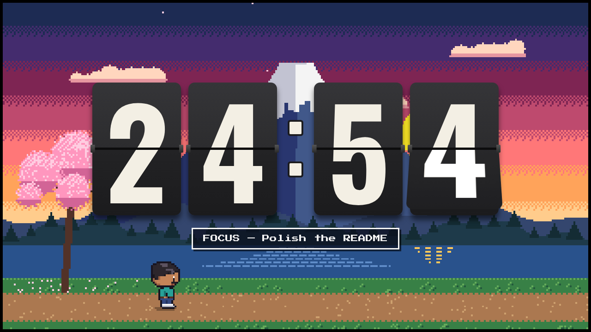 **Mt Fuji** · sunset · cherry petals | 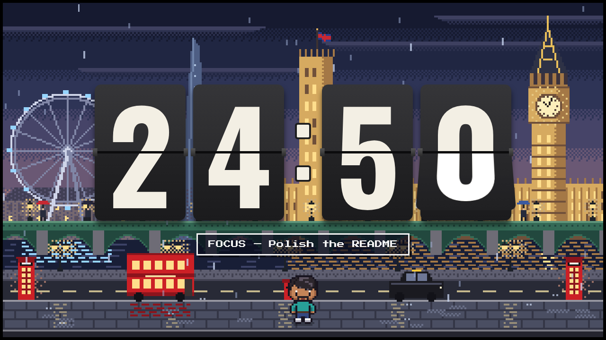 **London** · rainy blue hour · rain |
| 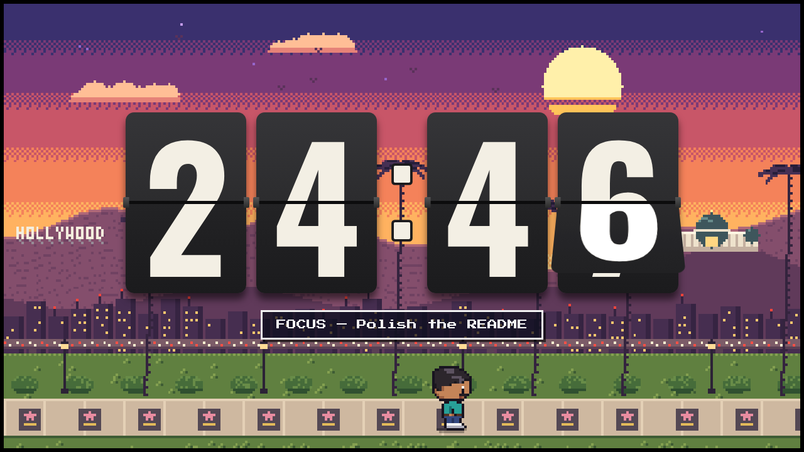 **Los Angeles** · golden hour · jacaranda | 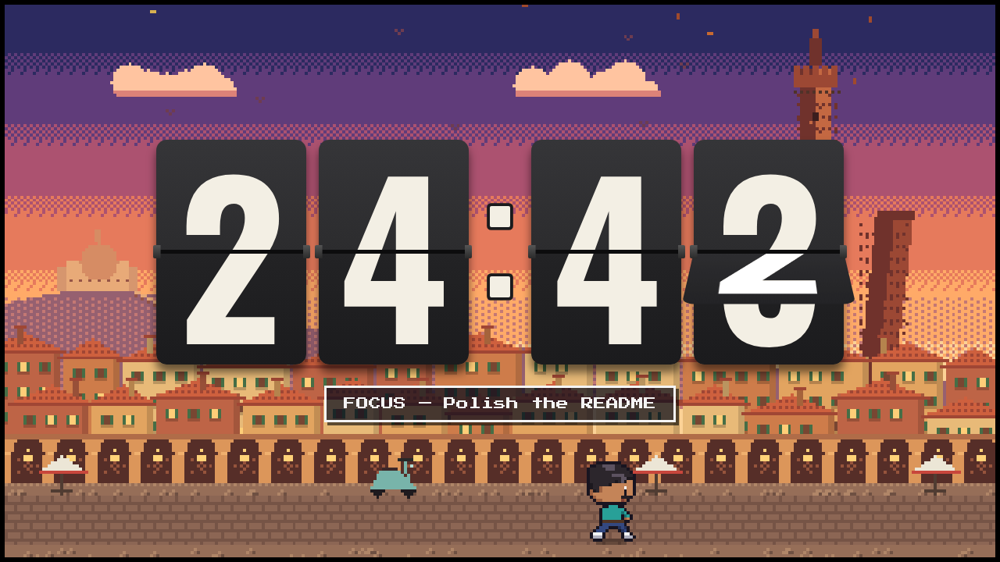 **Bologna** · warm evening · autumn leaves |
| 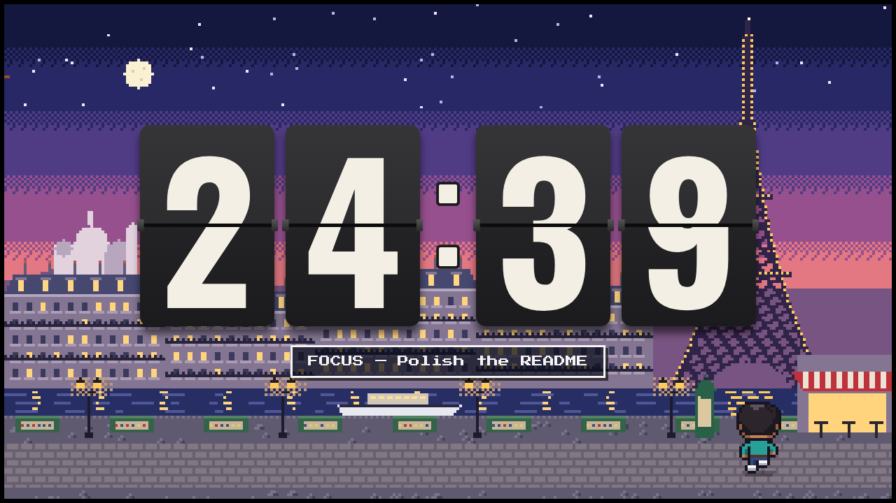 **Paris** · dusk · autumn leaves | 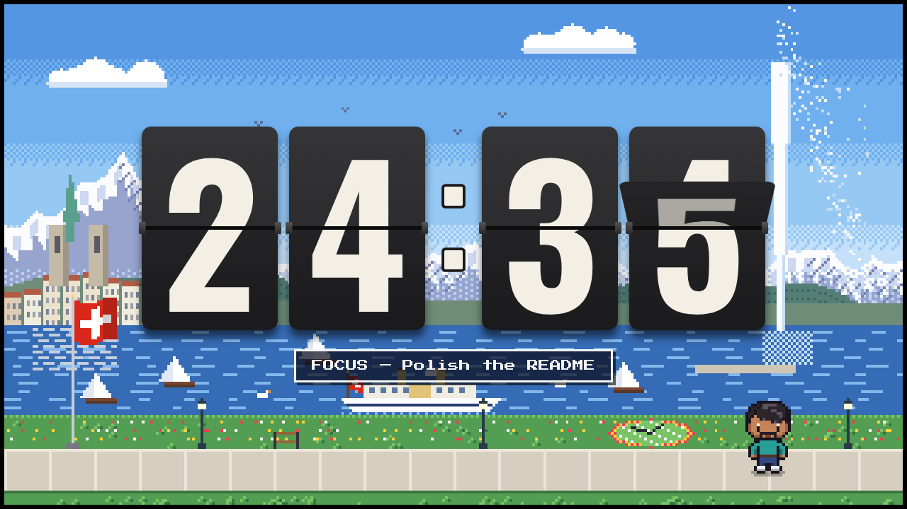 **Geneva** · bright morning · fountain mist |
| 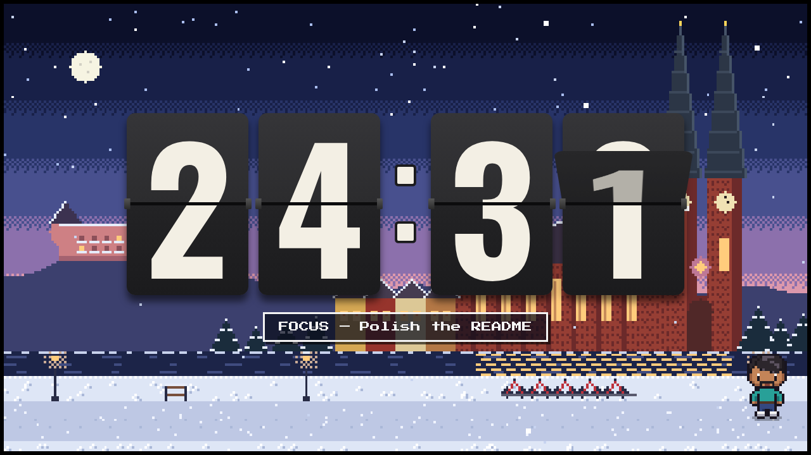 **Uppsala** · winter twilight · snow | 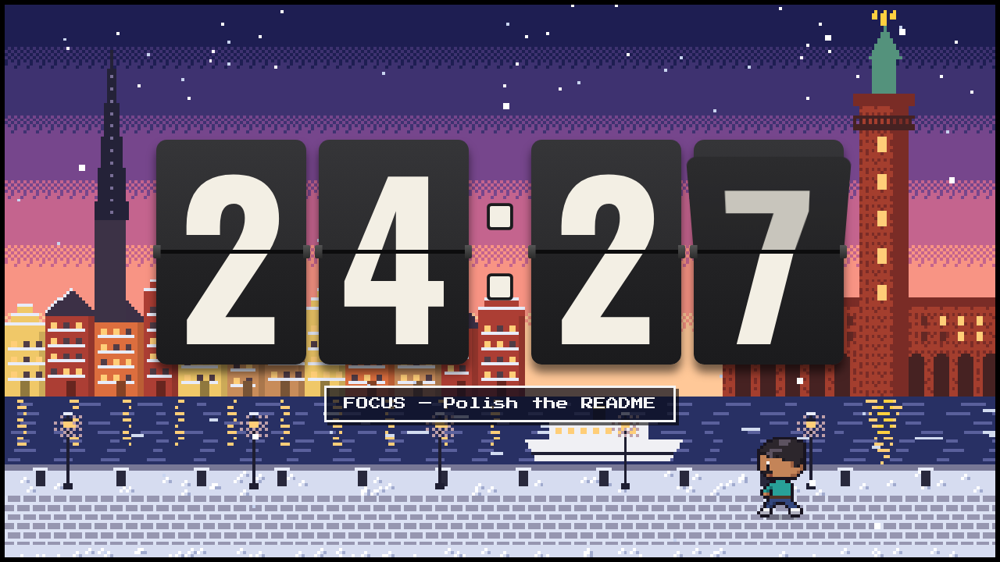 **Stockholm** · pink twilight · snow |
| 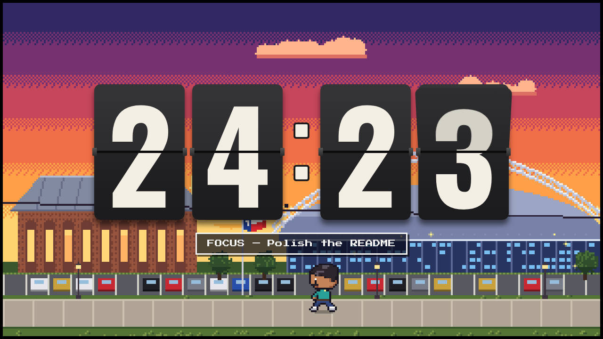 **Arlington** · Texas sunset · fireflies | 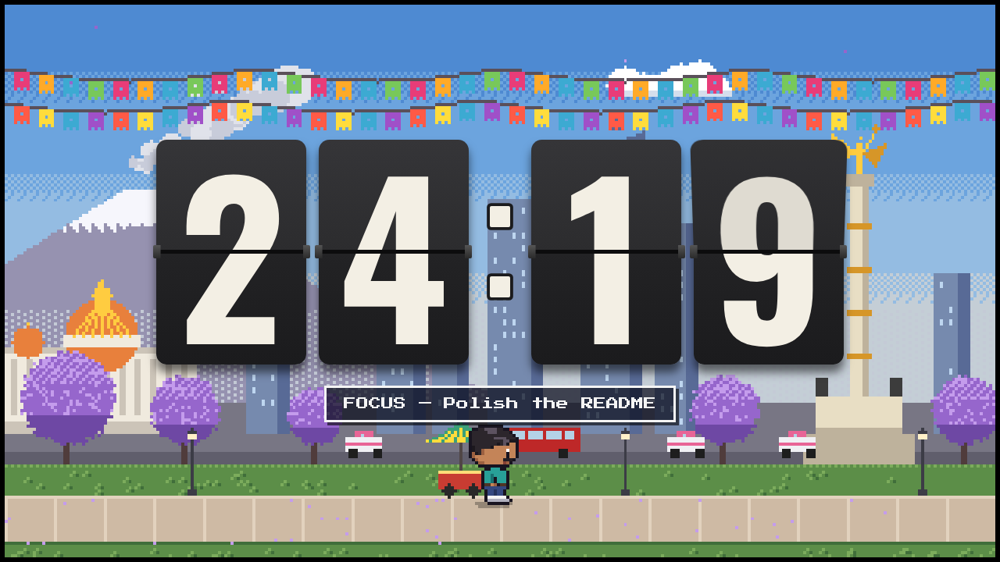 **Mexico City** · hazy afternoon · jacaranda |
| 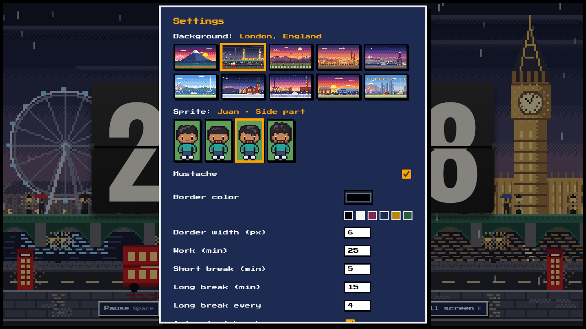 **Settings**: scene, sprite, frame, durations | 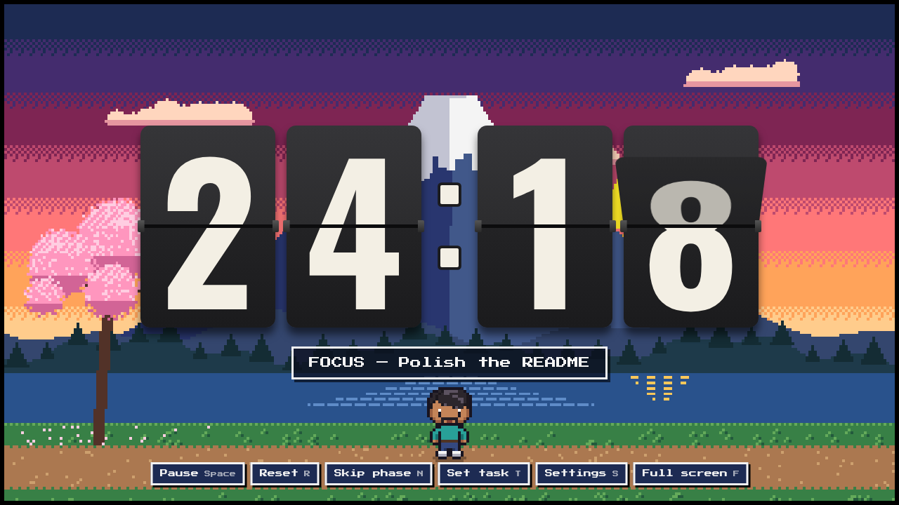 **Controls** appear on mouse move or tap |

## Quick start

| Platform | How |
|---|---|
| **Android** | Download the APK from [Releases](https://github.com/Jcardenas34/pomodoro_timer_pixel/releases/latest) and open it on the phone. Allow "install unknown apps" for your browser or file manager when asked. The APK is debug-signed, so Play Protect may warn you once. |
| **Windows** | [Build the `.exe`](#build-a-clickable-windows-app-exe) once, then double-click it. Or [run from source](#run-it-natively-on-windows-powershell). |
| **Linux / WSL** | [Run with conda](#run-it-with-conda-wsl-bash). |
| **Any browser** | [Browser-only dev mode](#browser-only-development-works-from-wsl). |

## How it works

- **Backend (Python):** a pywebview window, SQLite for settings and sessions, and Pillow for drawing every scene and sprite sheet procedurally. Nothing is hand-drawn in an image editor.
- **Frontend (TypeScript + Vite):** a canvas scene with wandering sprites and particle effects, the split-flap clock, and a deadline-based timer state machine.
- **Android:** the same frontend in a Capacitor shell. There is no Python on the phone; the art is pre-rendered to PNGs and an on-device backend (`src/local.ts`) mirrors `storage.py`.

---

## Running and building

### Run it with conda (WSL bash)

This runs Linux Python inside WSL. The window appears on your Windows desktop through WSLg, using Qt WebEngine from conda-forge, so no `sudo apt` is needed.

```bash
git clone https://github.com/Jcardenas34/pomodoro_timer_pixel.git
cd pomodoro_timer_pixel
conda env create -f environment.yml       # one time
conda activate pixel-pomodoro
(cd frontend && npm install && npm run build)
python -m pomodoro --windowed             # drag to monitor 2, then press F
```

Full screen from WSLg may open on your primary monitor. Starting with `--windowed`, dragging the window to the second monitor and pressing `F` is the reliable way.

Under WSL the app renders with SwiftShader (`--use-gl=swiftshader`), Chromium's built-in software GL, because the GPU path breaks under WSLg. It reaches about 46 fps at 1080p. Override this with `QTWEBENGINE_CHROMIUM_FLAGS` if needed. Data lives in `~/.local/share/PixelPomodoro`.

After changing `environment.yml`, update the env with `conda env update -f environment.yml --prune`.

### Run it natively on Windows (PowerShell)

Use **Windows** Python, not WSL, so the app gets a native WebView2 window that can go full screen on your second monitor.

```powershell
cd frontend
npm install
npm run build
cd ..
py -m pip install -e backend
py -m pomodoro --screen 1      # 0 = primary monitor, 1 = second monitor
```

Options:
- `--windowed` starts windowed instead of full screen.
- `--dev` loads the Vite dev server (`npm run dev`) with devtools.

Data (settings, session history, generated art) lives in `%APPDATA%\PixelPomodoro`.

### Build a clickable Windows app (.exe)

This bundles Python, the backend and the built frontend into one `dist\PixelPomodoro.exe`, so you can start the app without opening a terminal. Run it in **Windows PowerShell**, not WSL, because PyInstaller can't cross-compile.

```powershell
powershell -ExecutionPolicy Bypass -File scripts\build-exe.ps1
```

The script:
1. Builds the frontend.
2. Installs the backend and PyInstaller.
3. Writes the Fuji icon to `build\PixelPomodoro.ico`.
4. Runs `PixelPomodoro.spec`.

To use the exe:
- Double-click it, or right-click it to pin it to Start or the taskbar.
- To open full screen on your second monitor, make a shortcut and add `--screen 1` to the end of its *Target* field.
- The exe keeps its data in `%APPDATA%\PixelPomodoro` like any other run, so your settings and history carry over.
- Rebuild after you change the code.

<a id="android"></a>
### Android

**Install the prebuilt APK:** grab `PixelPomodoro-*.apk` from [Releases](https://github.com/Jcardenas34/pomodoro_timer_pixel/releases/latest), open it on the phone, and allow "install unknown apps" when asked. Installing a newer APK over the old one keeps your settings and history.

**On the phone:**
- The app is landscape and immersive full screen.
- Tap anywhere to show the controls: Start/Pause, Reset, Skip phase, Set task, Settings.
- Back closes a panel. When no panel is open, Back minimizes the app.
- The screen stays on while the timer runs.
- If you lock the phone or switch apps mid-phase, a notification plays the same 8-bit chime at the deadline. Allow notifications when asked on first launch. If the phone is on silent, the chime stays silent.
- Photo upload is not included on Android.

#### Build the APK yourself (WSL, no sudo)

One-time setup:

```bash
conda env update -f environment.yml --prune   # adds JDK 21
conda activate pixel-pomodoro
bash scripts/setup-android-sdk.sh             # Android SDK -> ~/Android/Sdk, Windows adb.exe
# then add the two exports it prints (ANDROID_HOME, WIN_ADB) to ~/.bashrc
```

On the phone (once): open Settings → About phone and tap *Build number* 7 times, then turn on *USB debugging* under Developer options, plug the phone in and accept the "Allow USB debugging" prompt.

Build and install:

```bash
cd frontend
npm run android:build     # exports art + chimes, builds web app, syncs, gradle assembleDebug
npm run android:install   # adb install -r (via Windows adb.exe from WSL)
```

The APK is at `frontend/android/app/build/outputs/apk/debug/app-debug.apk`. Without USB, copy that file to the phone and tap it.

### Browser-only development (works from WSL)

```bash
cd backend && python3 -m pomodoro --export-demo ../frontend/public/demo
cd ../frontend && npm run dev        # http://localhost:5173
```

Without pywebview, the frontend falls back to an in-page backend (`src/local.ts`). It stores settings and sessions in localStorage and uses the exported demo art. The Android build uses the same backend.

## Keys

| Key | Action |
|---|---|
| Space | start / pause |
| R | reset the current phase |
| N | skip to the next phase |
| T | set the task you're working on |
| S | settings (scene, sprite, border, durations, auto-start, chime) |
| F | toggle full screen |
| Esc | close a panel |

Move the mouse to show the control bar. It hides again after 3 seconds.

## Scenes and sprites

Open Settings (`S`, or tap Settings on the phone) and tap a thumbnail to switch scenes. The choice is saved.

| Scene | Landmarks | Mood | Effect |
|---|---|---|---|
| Mt Fuji | Fuji, cherry tree, lake | sunset | cherry petals |
| London | Elizabeth Tower (Big Ben), Parliament, Westminster Bridge, the Eye, the Shard, a Routemaster bus, a black cab, phone boxes | rainy blue hour | rain with splashes |
| Los Angeles | Hollywood sign, Griffith Observatory, palms, the 101, Walk of Fame stars | golden hour | jacaranda petals |
| Bologna | Due Torri, San Luca on its hill, green shutters, porticoes, café parasols, a Vespa | warm evening | autumn leaves |
| Paris | lattice Eiffel Tower, Sacré-Cœur, Haussmann balconies, the Seine, a bateau-mouche, bouquinistes, a café, a Morris column | dusk | autumn leaves |
| Geneva | Jet d'Eau, Mont Blanc, Vieille Ville and St-Pierre, Swiss flags on a quay flagpole and on the paddle steamer, the Horloge fleurie | bright morning | fountain mist |
| Uppsala | cathedral spires with clocks, castle, falu-red houses with Advent stars, a bike rack | winter twilight | snow |
| Stockholm | Stadshuset, Gamla stan stepped gables, Riddarholmen, an archipelago steamer, drift ice | pink twilight | snow |
| Arlington | AT&T Stadium arches, Globe Life Field, game-day parking, the Texas flag | Texas sunset | fireflies |
| Mexico City | Ángel de la Independencia, Popocatépetl, Bellas Artes, papel picado, Metrobús, pink taxis | hazy afternoon | jacaranda petals |

The walking sprite is **Juan**. Pick his look under Settings → Sprite:
- **Original**: the first Juan, with wavy tufts and no mustache
- **Crew cut** (short)
- **Side part** (short-medium, the default)
- **Wavy** (medium)

The **Mustache** checkbox under the picker turns the mustache on or off for the three hairstyles; the thumbnails follow it. Both choices are saved, and switching swaps him in place on the path.

**To add a scene:**
1. Write a generator in `backend/pomodoro/imaging/cities.py` using the `paint.py` helpers.
2. Add it to `CITIES`.
3. Bump `BUILTIN_VERSION` in `assets.py`.
4. Rebuild.

Keep the landmark on a side third, because the clock covers the middle of the screen. Keep important detail below y≈40, because phones crop the top of the sky.

**To add a hairstyle:** add 16×16 head grids for `down`, `up` and `right` to `HAIRSTYLES` in `sprite_template.py`, give it a name in `HAIRSTYLE_NAMES`, and bump `BUILTIN_VERSION`. Role `U` is facial hair; a palette can map it to the skin color for a clean-shaven sprite.

## Tests

```bash
python3 -m pytest tests        # art generators, sprite template, storage, chimes
cd frontend && npm test        # timer state machine, scene, on-device backend
```

## Regenerating the screenshots

The images in `docs/screenshots/` are captured from the browser-only build with headless Chromium (Playwright):

```bash
cd backend && python -m pomodoro --export-demo ../frontend/public/demo
cd ../frontend && npm run build && npm run screenshots
```

`frontend/scripts/capture-screenshots.mjs` takes the stills and GIF frames; `scripts/make-hero-gif.py` assembles `hero.gif`.

## Project layout

- `backend/pomodoro/imaging/builtin.py`: procedural Mt Fuji scene (320×180)
- `backend/pomodoro/imaging/cities.py`, `paint.py`: the nine city scenes and their shared pixel helpers
- `backend/pomodoro/imaging/sprite_template.py`: role-coded walk-cycle template (hair/skin/shirt/pants/shoes)
- `backend/pomodoro/imaging/sprite.py`: recolors the template into a sprite sheet
- `backend/pomodoro/audio.py`, `android_art.py`: chime WAVs, launcher icons, splash (`--export-android`), Windows icon
- `frontend/src/flipclock.ts`: split-flap digits
- `frontend/src/scene.ts`: canvas scene, wandering sprites, weather effects
- `frontend/src/timer.ts`: deadline-based pomodoro state machine
- `frontend/src/local.ts`: on-device backend (Android and browser), mirrors `storage.py`
- `frontend/src/android.ts`: keep-awake, phase-end chime notification, back button
- `frontend/android/`: Capacitor Android project (landscape, immersive `MainActivity`)
- `PixelPomodoro.spec`, `scripts/build-exe.ps1`: Windows exe build

## Roadmap

- [x] Fuji scene, walking sprite, flip clock, configurable frame
- [x] Android app
- [x] Nine more city scenes with weather effects
- [x] Sprite hairstyles
- [x] Single-file Windows `.exe`
- [ ] Stats panel (session logging is already in place)
- [ ] Photo bank: upload photos → 8-bit backgrounds and likeness sprites

## License

[MIT](LICENSE) © 2026 Juan Cardenas
